# V2.3 — PWA architecture and safety contract

## Decision

Use SvelteKit's native service-worker build, manual capability-driven registration and a small typed worker. No Workbox or new runtime dependency. Installed stack: Kit3.1.0, Svelte5, Vite8, static adapter4; configuration lives in the existing Vite plugin, not a second svelte.config file. Kit3 provides `immutable`, `assets`, `prerendered` through `$app/manifest`, plus a separate worker TypeScript context. [Official native documentation](https://svelte.dev/docs/kit/service-workers).

| Option                        | Benefit                                                                                                   | Trade-off for this product                                                                                                                               |
| ----------------------------- | --------------------------------------------------------------------------------------------------------- | -------------------------------------------------------------------------------------------------------------------------------------------------------- |
| Native Kit worker             | Existing build pipeline and generated resource inventory; no package/runtime addition; explicit lifecycle | We own admission, complete-cache verification, retention and client-version tests                                                                        |
| @vite-pwa/sveltekit / Workbox | Manifest tooling and supported generation/injection strategies                                            | Additional build/runtime dependency surface; default glob coverage still needs fonts/workers review; custom multi-client/update policy remains necessary |

The [PWA integration documentation](https://vite-pwa-org.netlify.app/frameworks/sveltekit) describes output globs and custom-worker integration; it does not establish compatibility with this exact Kit3/Vite8 lockfile. We do not install or claim an integration experiment that has not run. Native is sufficient for the needed static scope, with materially less new machinery. [MDN lifecycle/security context](https://developer.mozilla.org/en-US/docs/Web/API/Service_Worker_API) informs the implementation; no generic runtime caching from example code is adopted.

## Inventory and integrity

After adapter-static finishes, a build finalizer enumerates its real public files, checks generated metadata/tool route coverage and injects a static inventory (canonical path, MIME class, bytes, SHA256) into the native bundled worker. This covers lazy CodeMirror/Konva/Rough imports, emitted workers, fonts, prerendered navigation payloads and HTML, without maintaining a second30-slug list. `service-worker.js`, host-only headers/redirect rules and the inventory's own file are excluded from the digest loop. The generated public inventory is build metadata only, never runtime documents.

Complete preparation fetches only this inventory with credentials omitted, no redirects and explicit response/body integrity verification. Six bounded requests may run concurrently. A static inventory record is put in the version cache only after every resource passes. Existing complete caches are never overwritten by a different inventory claiming the same build identity. Failure leaves the active old cache intact; partial new entries are not Ready. The worker never writes incoming application requests or results to caches.

Admission requires exact same-origin HTTP(S) path, GET, empty search, expected destination and a declared resource. Authorization/range requests bypass it. Redirects, opaque/error responses, private/no-store responses, unsafe Vary and unexpected MIME reject preparation. Unknown navigations receive the cached genuine404 document with status404; arbitrary requests and query-bearing paths do not become cache keys. A cache miss for an old build cannot silently fetch a newer mutable resource into its shell.

The deployed-host gate found Pages canonicalizes root `.html` URLs with308. Consequently the finalizer preserves the original host404.html but precaches its explicit `/offline-not-found/` directory-index copy; incomplete recovery also uses `/offline-unavailable/`. These portable directory URLs work without accepting redirects or depending on Firebase clean-URL rewrites. Build-only index canonicalization is not applied to arbitrary incoming requests. The compressed controlled server reproduces this hosting rule to prevent recurrence.

## Version affinity and activation

Visible build SHA and Kit version share the explicit build identity. Default identity is Cloudflare's commit SHA / local Git HEAD; a documented test-only build override produces two distinguishable real artifacts. Do not reuse an identity for changed deployed bytes. Cache names use a DevBench-only namespace and this identity; no Canvas database operations occur in the worker.

Each page installs a build-identification listener. A worker asks the originating window through MessageChannel when serving mutable navigation data, manifests or HTML fetched by that old client. No client identity or payload is persisted. Exact hashed resources may be recovered from retained declared inventories; nonhashed resources require a matching client build. A full document navigation starts on the active new build, while an already-running old shell keeps its own resource set. Unknown/unresponsive clients are handled conservatively, never guessed as new.

New versions fully download while the existing version remains active. No unconditional skipWaiting, claim or controllerchange reload. Only an explicit Update → Apply update action can request waiting-worker activation. Initial complete installation may claim clients only when every identified window is running that same build; otherwise a voluntary guarded reload enables control. Update activation does not claim uncontrolled older documents. Other tabs never reload automatically and identify their old build after controller changes.

Retain all identified live-client builds, active build and one unused rollback build. If any live client cannot be identified, postpone cleanup rather than deleting possibly needed code. This means long-lived/unresponsive tabs can require more storage than two builds; no hard cap may erase their resources. Partial unused caches are eligible for cleanup. Only named DevBench static caches are touched, never other caches, IndexedDB or user projects. Browser eviction/site-data deletion remains outside application guarantees.

## State and user work

```mermaid
stateDiagram-v2
  Unprepared --> Preparing: Prepare offline
  Preparing --> Ready: all entries verified + controller
  Preparing --> RecoverableError: network / integrity / quota
  RecoverableError --> Preparing: Retry
  Ready --> OfflineReady: connectivity hint offline
  OfflineReady --> Ready: connectivity hint online
  Ready --> Incomplete: verified entry missing
  Ready --> UpdateDownloading: newer worker installing
  UpdateDownloading --> UpdateReady: complete candidate waiting
  UpdateDownloading --> Ready: candidate fails; old cache retained
  UpdateReady --> Deferred: Later
  Deferred --> UpdateReady: show update
  UpdateReady --> ConfirmReload: Update
  ConfirmReload --> UpdateReady: Cancel
  ConfirmReload --> Applying: explicit Apply + Canvas save guard
  Applying --> Ready: activation + second guard + voluntary reload
```

Ready is based on verified cache coverage and worker control, not navigator.onLine. Online/offline is a hint; an incomplete cache remains incomplete even when network is present. Status/progress is metadata only. Preparation and update notices do not block editing or overlay Canvas. Error messages distinguish unavailable resources, cache/quota failure and unsupported APIs without exposing input contents.

Ephemeral inputs are deliberately not saved for updates. Reload acknowledgement explains their loss. Canvas registers minimal per-layout callbacks for pending editing, existing autosave.flush and existing rescue JSON export. Check before activation and again immediately before voluntary reload; failed save or active gesture keeps the editor open and offers rescue/cancel. Domain, history, CAS, serialization and database version are unchanged.

## Validation gates

Use production static builds on loopback (secure context) and real Chromium service workers. Prepare once, disconnect via context.setOffline(true), then run operations on all30 registry entries—including never-visited lazy workspaces and actual workers. Inspect cache keys and bodies for synthetic markers. Exercise frozen Canvas v1/v2/v3, rasters, hierarchy, undo/save/reload/JSON/PNG and concurrent tabs.

Two genuine differently identified builds are served successively by a controlled static server: keep A editing, fail B preparation midway, retain A, retry B, defer, load an unvisited old chunk, explicitly activate/reload one client and keep another old tab working. Delete a cache entry and inject an explicitly labeled quota failure to verify honest readiness/recovery. Do not use lifecycle mocks as the principal proof, sleeps as a replacement for observable state, global retries or certificate bypass.

Installation capability, standalone layout emulation and physical native installation are separate evidence categories. Firebase configuration is prepared for static root hosting; no project credentials or deployment are invented. Current state, measured sizes and outstanding gates remain in GOAL_PROGRESS_V23.md until actual evidence is available.
